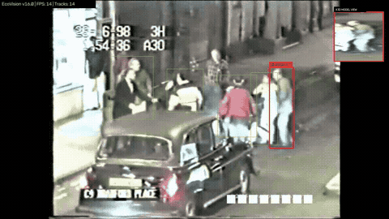
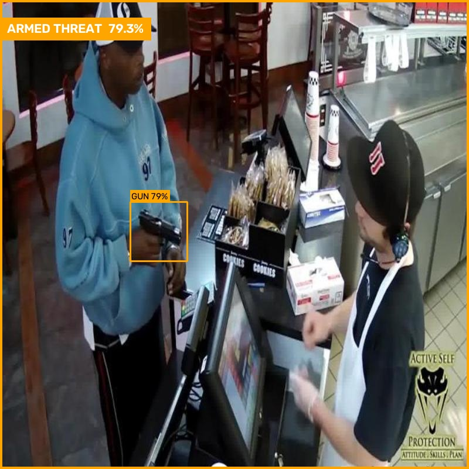
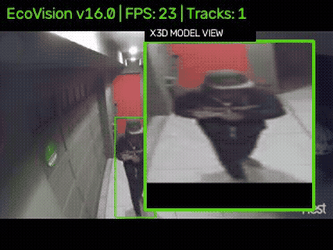
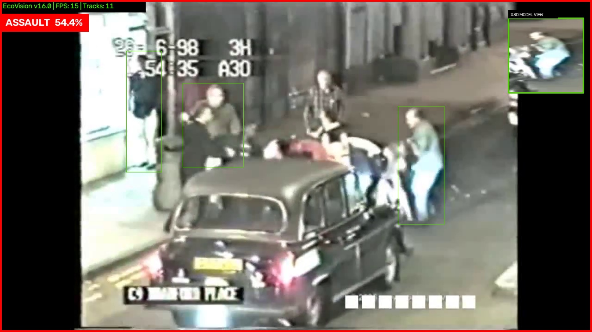
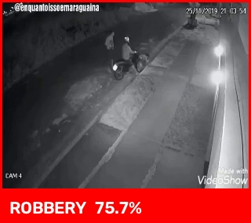
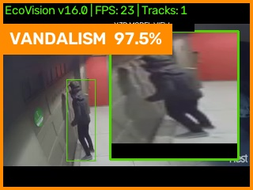

# EcoVision Security Sentinel

[](https://github.com/unknowndevice077/ecovision-crime-detection-ai/releases)
[](LICENSE)

Real-time AI-powered security monitoring and threat detection system. It watches a live camera feed, tracks people, detects weapons and violent behavior, and raises alerts — all through a single desktop app with a live dashboard.

Built for **always-on deployment**: the intended use case is a dedicated machine (with a GPU) running continuously, watching a camera feed 24/7 and flagging incidents automatically for review.

> **Status (as of 7 Oct 2026) — testing phase.** The full pipeline runs end-to-end: backend, AI core, dashboard and desktop shell. All four detection classes — violence, weapons, vandalism and robbery — are trained, measured on cameras they never trained on, and individually toggleable from the AI Models tab; robbery and vandalism are labelled **experimental** in the app. Since August the access model grew a DevTeam console, permissions that can be narrowed to single cameras or crime types, custom roles, identity verification, barangay→police report requests and a full audit log (see [Organization & Roles](#organization--roles)). [START_HERE.md](START_HERE.md) has the live model table; [docs/detection_performance_report.md](docs/detection_performance_report.md) has every number and how it was measured.
>
> | Detector | Caught | False alarms on held-out cameras |
> |---|---|---|
> | Violence (two-model ensemble, person-crop confirmed) | 88.0% of 200 fights | 2.0 / hr |
> | Weapons (`weapons_v3`, 960 px) | 89.6% of large guns, 39.4% of street-size guns | see report (needs a person holding it to alert) |
> | Vandalism (person-crop confirmed) — experimental | 87.1% of 31 acts | 1.0 / hr |
> | Robbery — experimental | 39.8% of test clips | 0.5 / hr |


## What It Does

The system runs three integrated components, packaged as one desktop application:

### 1. **AI/Vision Core** (`maincode/main.py`)
- Pulls frames from a camera feed — chosen at runtime by index or by **name** (e.g. `"OBS Virtual Camera"` resolves to whatever index OBS has on that machine), or a video file path for repeatable replays
- Runs YOLO11-pose for multi-person tracking (each tracked person gets an independent detection state — not limited to one person on screen)
- YOLO weapon detector (`weapons_v3.pt`, gun/knife/phone, run at 960 px) feeding an independent "ARMED" alert path — per-class gates, a weapon tracker, a static-object filter, and weapon-to-wrist assignment via the pose keypoints
- X3D-XS whole-frame video classifiers for violence (two models averaged), robbery and vandalism, each with its own threshold, temporal smoothing and consecutive-check confirmation; violence and vandalism also require **person-crop confirmation**
- A graffiti/marks YOLO detector (`vandalism_marks_v2.pt`) as a second vandalism signal, and a composite robbery rule (armed/violent person + sustained proximity) as a model-free hint alongside the robbery classifier
- All alert decision rules live in one module, `maincode/detection_rules.py`, which the evaluation scripts import too — so the numbers in the docs come from the exact rules that ship
- "Episode" tracking per track/pair so a continuously-active state (e.g. one ongoing assault) mints one incident, not one every frame
- GPU (CUDA) used automatically when available, with `.engine` (TensorRT) preferred over `.pt` when present; falls back to CPU
- Configured through `config.json`, **not** through `.env` — the AI core never loads a `.env` file

### 2. **Backend API** (`app/backend.py`, FastAPI)
- Stores alerts, incident records, and video clips
- Dual database backend: **SQLite by default**, Postgres when `DATABASE_URL` is set — see `app/db.py` and [Database](#database) below
- Manages connected device (ESP32) telemetry and siren control; siren calls report whether the board was actually reached (`sent` / `skipped` / `unreachable`) instead of assuming success
- Role-based auth (JWT) and permissions system, with every scoped query going through one `scope_clause()` helper so cameras, incidents and records can't disagree about who sees what; permissions are re-read from the database on every request, so a revoked permission takes effect immediately
- **Audit log** of every change (who, what, when, before/after), with soft-delete and restore for users and incidents
- **Responder notifications** — Telegram (primary) and SMS via Semaphore (fallback), per barangay/station notify targets (`app/notifications.py`, `app/telegram_bot.py`)
- **Report drafts** — when an incident is confirmed, a police-report draft is filled in from the incident's own data (time, place, detector, confidence, people in view, weapons, evidence on file) for the officer to edit and confirm; it is template-based, not a language model
- **Detection feedback** — every operator Confirm / Dismiss is stored as a labelled example (`detection_feedback`), and `tools/export_feedback_dataset.py` turns them into a training set
- Serves data to the dashboard over REST + a shared `/ws` WebSocket for live push updates

### 3. **Dashboard (Frontend)** (`app/`, Next.js App Router)
- Dark tactical UI, code-split per tab (`next/dynamic`) so only the active tab's code loads
- Live alerts with severity levels, pushed over the shared WebSocket (`app/context/WebSocketContext.tsx`)
- Incident records and DVR-style footage playback (`RecordsView`, `HistoryView`)
- Crime map with Leaflet (`CrimeReportsView`) — camera and smartpole pinning, jump from an incident to its footage
- Fullscreen camera wall that keeps the incident queue beside it; side-by-side incident review
- DevTeam **Developer Console**, split into *Monitoring* (directory, users, AI model health, per-camera alert precision) and *Configuration* (create users and roles, stations, approvals, verification, permissions, audit log)
- Admin consoles for barangay and police administrators (their own staff, permissions and notify targets)
- Device status monitoring (ESP32 telemetry)

### 4. **Desktop Shell** (`electron/`)
- Electron wrapper for one-click launch
- Automatically starts backend and AI core as child processes, negotiates free ports if the defaults are taken, and writes the resolved ports to `runtime_ports.json` for the frontend to read
- Opens the dashboard pointed at the resolved local services

## How Detection Actually Works

Every detector runs on the same live feed and shares the same pipeline shape: **pose tracking finds the people, a classifier scores what they're doing, and a confirmation rule decides whether that score becomes an alert.** What differs per class is which classifier and which rule.

**1. YOLO11-pose tracks everyone in frame, continuously.** Every person gets a stable track ID and their own detection state — a fight breaking out on one side of frame doesn't interfere with tracking someone walking on the other. The small picture-in-picture box in the corner shows exactly what's being fed into the violence classifier at that instant — the same crop the model sees, not a mockup:



**2. Violence and robbery run an X3D-XS video classifier** — a 3D-convolutional network that looks at a short clip (13 frames), not a single image, because a raised fist and a wave look identical in one frame and completely different across ten. For violence, **two independently trained X3D-XS models score the same clip and their calibrated probabilities are averaged** (an ensemble: they make different mistakes, so the average makes fewer), and the whole-frame score is then **confirmed against crops around the people the pose model found** — the value that goes on to smoothing is the *lower* of the whole-frame score and the best person-group crop over the last three checks, so a busy street with no actual struggle can't raise an alarm on its own. Two modes exist: **scene mode** (the default) classifies the whole frame every few frames, which is more accurate on this dataset (measured: 79.0% accuracy / 76.0% recall vs. 69.5%/65.5% for per-track alone) at deciding *whether* a frame is violent. It used to also be cheaper, on the assumption that deciding *who* it involves didn't matter — it did: a real evidence frame showed the wrong person highlighted, because scene mode broadcast the same whole-frame verdict to everyone on screen and let whichever person's own confirmation counter happened to fire first win the box, with no relationship to who was actually involved. Fixed 3 Sep by always running the per-track model too and using its own score for attribution — confirmed on real multi-person footage: the one person visibly walking away from a fight scored 0.43 while people in the actual altercation scored 0.89–0.99, a real, meaningful gap, not noise. Scene mode still decides whether an alert fires; the per-track score now decides who gets boxed, and a frame with no individual score to back it up shows the alert banner with no one singled out, rather than guessing. The trade: cost now scales with how many people are in frame again, the thing scene mode was originally chosen partly to avoid. Robbery uses the identical scene architecture with its own checkpoint and threshold, run independently — a robbery involving a shove should be able to raise both alerts, not have one steal the other's probability mass. Below: the deployed robbery checkpoint firing on real CamNuvem CCTV footage its training run never saw, going from quiet to a confirmed alert at 75.7% as the buffer fills:


**3. Weapon detection is a separate YOLO object detector** (`weapons_v3.pt`, run at 960 px so street-camera-size weapons still have enough pixels) — it scans each sampled frame for guns and knives, on its own detection interval, feeding an independent alert path (`ARMED THREAT`) that can fire even if the violence classifier stays quiet. Raw detections pass per-class confidence gates (gun 0.30, knife 0.23), are tracked across frames, are dropped if they never move (a gun printed on a poster), and are then assigned to a person's wrist using the pose keypoints, so the alert is about *an armed person*, not just a gun-shaped object. v3 was fine-tuned on 7,500 synthetic street-camera frames — real gun and knife cut-outs pasted at the wrists of real people in our own Davao footage, at street-camera scale — which cut false weapons on street footage about 8× and lifted recall on street-size guns from 14% to 39%. (Classes are gun/knife/phone; phone exists only to teach the model what a *raised hand holding something small* usually isn't.) No live camera in this dataset has ever caught a real gun or knife in frame, so rather than fabricate one, here's the deployed detector scoring a real, held-out photo it never trained on:



**4. Vandalism runs two independent signals side by side.** The same X3D-XS architecture from point 2 gets its own checkpoint trained specifically on vandalism footage (`x3d_xs_vandalism_scene_v3.pt`, with the same person-crop confirmation as violence) — this is what fired below, at a real, measured 97.5%, not a placeholder number. Alongside it, a purpose-built graffiti/tag YOLO detector (`vandalism_marks_v2.pt`) spots an actual mark on a wall, gate, or shutter and arms a separate wrist-motion rule that looks for sustained spraying motion near it with nobody else close by (to tell spraying apart from a scuffle). Either signal can raise the alert on its own:



**Every alert clears the same bar before it reaches a human:** a confidence threshold *and* a run of consecutive confirming checks after exponential smoothing, with hysteresis on release so an alarm doesn't flicker (all tunable per detector, and per-camera — see `docs/progress_report_violence_detection.md` §28.1), so one noisy frame can't mint an incident on its own. The deployed settings: violence 0.45 × 2 checks, vandalism 0.60 × 3, robbery 0.85 × 3. Once it does, "episode" tracking makes sure one continuously-active event — one ongoing fight, one person still spraying — produces exactly one incident, not a fresh one every time the check interval ticks over. The moment it fires, the system burns a timestamped, confidence-labeled banner onto a still frame (never onto the live feed itself — the operator's view stays clean) and starts writing a real H.264 clip in the background, both of which land on the incident automatically:

| Violence — 54.4% confidence | Robbery — 75.7% confidence | Vandalism — 97.5% confidence | Weapon — 79.3% confidence |
|---|---|---|---|
|  |  |  |  |

Every one of these thresholds, and every accuracy number quoted above, comes from `docs/detection_performance_report.md` and `maincode/eval_history.csv` — measured on held-out clips the training run never saw, not asserted.

## Key Features

- ✅ **Real-time detection pipeline** — pose tracking, weapon detection, and violence classification, all per-person (multi-person scenes supported)
- ✅ **Severity-tagged alerts** — incidents ranked LOW → CRITICAL with confidence scores
- ✅ **Records & DVR view** — auto-captured incident clips (H.264, browser-playable), real ffmpeg-based clip extraction and delete from the Recordings tab. 24/7 continuous archive is **not built yet** — an earlier placeholder writer that saved a black frame with a timestamp overlay (and never registered a `video_records` row for any of it) has been removed rather than left running; the 24/7 tab is honestly empty pending a real implementation, instead of quietly burning disk space for a feature nobody could see.
- ✅ **ESP32 device integration** — hardware connectivity and live telemetry (battery, solar voltage, temperature), remote siren activation with a dashboard emergency-stop and an honest delivery status, a physical panic button that posts a real incident **with a photo captured at the moment it was pressed**, and auto-discovery (the board self-registers its IP with the backend on boot and every 30s, so a DHCP lease change doesn't strand it)
- ✅ **Responder notifications** — Telegram and SMS (Semaphore) alerts to the notify targets each barangay or station sets up
- ✅ **Report drafts** — confirmed incidents get a pre-filled police-report draft for the officer to edit and confirm
- ✅ **Learning from operators** — every Confirm / Dismiss becomes a labelled example; the AI Models tab shows per-camera precision
- ✅ **Two-organization access control** — barangay and PNP hierarchies with database-enforced scope; see [Organization & Roles](#organization--roles)
- ✅ **Runtime-selectable camera index** — no hardcoded camera number, switchable from the dashboard; `camera.source` also accepts a video file path for deterministic, machine-independent replay/testing
- ✅ **Self-contained desktop app** — single Inno Setup installer (`electron-builder` packages `win.target: dir`, `installer/EcoVisionSentinel.iss` wraps it), ships its own Python runtime (`python-env/`, the official embeddable distribution — not a venv), no separate Python or Node install needed on the target machine
- ✅ **Violence detection** — two-model X3D-XS ensemble with person-crop confirmation: 88.0% of 200 held-out fights (from 200 different source videos, spliced into continuous street footage) at 2.0 false alarms/hr on four held-out real cameras; 93.1% accuracy / 92.8% recall / 93.4% precision on 1,310 held-out test clips.
- ✅ **Weapon detection** — `weapons_v3.pt` at 960 px: 89.6% recall on guns filling 40%+ of the frame, 39.4% on street-camera-size guns (5–10% of the frame), 83.8% on street-size knives; about 8× fewer false weapons on street footage than v2. Small, distant guns remain the hard case. Independently toggleable.
- 🧪 **Vandalism detection (experimental)** — X3D-XS v3 with person-crop confirmation at 0.60 × 3: 87.1% of 31 held-out acts at 1.0 false alarm/hr (was 6.0/hr before confirmation). Few test source videos, so recall is approximate. A second, independent signal — the graffiti/tag detector `vandalism_marks_v2.pt` (mAP50 73.4%, recall 64.6%, precision 80.4% on a 165-image leakage-free test set) — arms the wrist-motion rule.
- 🧪 **Robbery detection (experimental)** — X3D-XS scene classifier at 0.85 × 3, tuned for few false alarms: 0.5/hr on held-out cameras (12/hr at the old 0.70), at the cost of catching only 39.8% of test clips. Several retrains — more UCF-Crime robbery, Davao street negatives, mined false alarms — were measured and rejected; a single glance at a frame can't tell a robbery from an ordinary hand-off in a busy market. See [Research in progress](#research-in-progress).

## Organization & Roles

Two separate organizations use the system, and the difference between them is **scope**, not seniority:

- A **barangay** owns the physical infrastructure — cameras, smartpoles, ESP32 devices. Everything a barangay user sees is filtered to their one `barangay_id`.
- A **police station** owns no infrastructure. It is a *lens*: a station is granted a **jurisdiction** — a set of barangays, via the `station_barangays` table — and its users see everything in those barangays. A station can cover several barangays, and DevTeam assigns that mapping.

There is no precinct tier.

| Role | Organization | Scope column | Can do |
|---|---|---|---|
| `DEVTEAM` | — | neither (unscoped) | Everything; manages stations, jurisdictions and location approvals |
| `BARANGAY_ADMIN` | Barangay | `barangay_id` | Everything within their barangay; creates `BARANGAY_STAFF` |
| `BARANGAY_STAFF` | Barangay | `barangay_id` | Operator, granular per-key permissions |
| `PNP_ADMIN` | Police station | `station_id` | Everything in their station's jurisdiction **except camera management**; creates `PNP_OFFICER` |
| `PNP_OFFICER` | Police station | `station_id` | Operator within the jurisdiction, granular per-key permissions |

Rules the database itself enforces (`chk_user_scope`, plus partial unique indexes):

- A barangay user has a `barangay_id` and no `station_id`; a PNP user has a `station_id` and no `barangay_id`; `DEVTEAM` has neither. Any other combination is rejected at insert time.
- One `BARANGAY_ADMIN` per barangay, one `PNP_ADMIN` per station.

`manage_cameras` is **barangay-only** (`BARANGAY_ONLY_PERMISSIONS` in `backend_core.py`): the barangay funded and installed the hardware, PNP consumes the feed. This holds for `PNP_ADMIN` too — an admin tier does not implicitly grant it. The reverse holds for the crime archive: `view_history` and `view_records` are **police-only** (`POLICE_ONLY_PERMISSIONS`) — a barangay account keeps its live incident queue but cannot open police case records, and the server refuses those two keys for barangay accounts even if a stale grant exists. Other permissions (`view_map`, `confirm_dismiss_alerts`, `manage_notify_targets`) are granular per user; see `app/hooks/usePermissions.ts` and the `user_permissions` table.

**Finer-grained access (added Sept 2026):**

- **Diced permissions** — a permission can be narrowed to specific resources instead of all-or-nothing: `view_map` / `manage_cameras` to particular **cameras**, `view_records` / `view_history` / `confirm_dismiss_alerts` to particular **crime types**, `manage_notify_targets` to a **channel** (`permission_grants` table). Barangay and police admins dice their own staff within their own organization; DevTeam can dice anyone's.
- **Custom roles** — a named permission preset (e.g. "Night Desk Officer") layered on top of `BARANGAY_STAFF` / `PNP_OFFICER`; the person is still that base role for every scope rule (`custom_roles`).
- **Identity verification** — every account can upload an ID document, stored on local disk and served only through an authenticated, permission-checked endpoint (never a public static path). Admins review their own staff; DevTeam reviews self-signup administrators as part of approving the barangay or station.
- **Report requests** — a barangay can formally request a specific report from its police station; the station accepts or declines, then fulfils it by sharing the report and any attached files, which the barangay can download (`report_requests`).
- **Applications** — self-signup barangays and stations go through a real lifecycle (pending → approved / rejected); rejected locations leave circulation.
- **Audit log** — every create, edit, permission change, deletion and restore is logged with the actor and a snapshot; deleted users and incidents are soft-deleted and can be restored from the log (`audit_log`).

> Role strings are embedded in issued JWTs, so a hierarchy change means everyone logs in again. Tokens from before the migration fail closed (no visibility) rather than widening.

Existing databases are moved onto this model by `app/migrate_pnp_hierarchy.py` (supports `--dry-run`, backs up the database first, and is idempotent).

## Tech Stack

| Component | Technology |
|---|---|
| Frontend | Next.js (App Router), React, Tailwind CSS v4, TypeScript |
| Desktop | Electron |
| Backend API | FastAPI (Python 3.11), SQLite or Postgres |
| AI/Vision | Ultralytics YOLO11 (pose, weapon and graffiti detection), PyTorchVideo X3D-XS (violence, robbery and vandalism classification), OpenCV, TensorRT (optional) |
| Hardware | ESP32 integration |
| Notifications | Telegram Bot API, Semaphore SMS |

## Repository Structure

```
EcoVisionCode/
├── app/                        # Next.js pages/components + FastAPI backend
│   ├── page.tsx                # Main dashboard shell (tabs lazy-loaded via next/dynamic)
│   ├── components/             # Tab views (CrimeReportsView, RecordsView, ProfileView, dashboard/*)
│   ├── context/WebSocketContext.tsx  # Shared live-update WebSocket + useLiveChannel hook
│   ├── hooks/                  # useRuntimeConfig, usePermissions
│   ├── backend.py              # FastAPI app: middleware, router mounting, uvicorn entry point
│   ├── backend_core.py         # Shared config, auth, DB setup/migrations, permissions, serializers
│   ├── routers/                # Endpoints, one module per area (auth, incidents, cameras, admin, devteam_*...)
│   ├── config_store.py         # Writes only changed config keys over config.json (no stale full snapshots)
│   ├── notifications.py, telegram_bot.py  # Telegram + SMS responder alerts
│   ├── db.py                   # SQLite/Postgres dual-backend shim
│   ├── migrate_pnp_hierarchy.py    # One-shot role/scope migration (--dry-run supported)
│   ├── reset_devteam_password.py   # Dev convenience, called by run_dev_system.bat
│   ├── port_utils.py           # Runtime port negotiation helpers
│   └── schema_final.sql / schema_sqlite.sql
├── alembic/                    # Postgres migrations (alembic.ini at root)
├── electron/                   # Desktop shell (main.js, setup/launch windows)
├── maincode/                   # AI/vision pipeline + model eval tooling
│   ├── main.py                 # Vision pipeline (pose + weapon + violence + robbery + vandalism)
│   ├── detection_rules.py      # Every alert decision rule, shared with the evaluation scripts
│   ├── robbery_vandalism.py    # Robbery/vandalism rule logic
│   ├── x3d_violence_detector.py    # X3D scene detector: ensemble, person-crop confirmation, smoothing
│   ├── test_x3d_true_heldout.py    # True held-out accuracy eval (live pipeline)
│   ├── generate_eval_report.py, calibrate_threshold.py
│   ├── confidence_trace_plotter.py # Plots live per-frame confidence trace
│   └── eval_history.csv        # Accuracy/recall/precision/FPR log across eval runs
├── docs/USER_HIERARCHY_PLAN.md # Organization/role design rationale
├── weights/                    # Model weights (gitignored, added manually)
├── optimize_weights.py         # Exports .pt -> TensorRT .engine
├── python-env/                 # Bundled runtime for the installer, built by tools/build_python_env.ps1 (gitignored)
├── config.json / config.development.json / config.production.json
├── requirements.txt / requirements-backend.txt / requirements-detector.txt
├── package.json
├── setup.bat                   # Environment setup (.venv + python-env)
├── run_dev_system.bat          # Development startup
├── start.bat                   # Packaged-style local run without building an exe
├── build_release.bat           # Local installer build
├── preflight.py                # Checks every required weight and setting before launch
├── tools/                      # Installer build, feedback-dataset export, figure/GIF generators
├── tests/                      # unittest/pytest suite: rules, permissions, audit, config, features
└── .github/workflows/          # CI (backend tests, installer build)
```

## Getting Started (Development)

### Requirements
- Python 3.11 (`torch==2.5.1+cu121` wheels are pinned to it)
- Node.js 18+
- Both available on your system PATH
- NVIDIA GPU with a CUDA 12.1-compatible driver, for anything beyond CPU-speed inference

### Setup

```bash
setup.bat
```

This command:
1. Installs frontend dependencies (`npm install`)
2. Builds the frontend (`npm run build`)
3. Creates `.venv` and installs `requirements.txt` — this is what `run_dev_system.bat` uses
4. Creates `python-env/` (via `tools/build_python_env.ps1`, the official embeddable Python distribution) and installs the same requirements — this is what `build_release.bat` bundles into the installer
5. Prints what to run next

Both installs pass `--extra-index-url https://download.pytorch.org/whl/cu121`, which `requirements.txt` also declares, because plain `torch==2.5.1` on PyPI is the CPU build. Steps 3 and 4 skip if the directory already exists — delete it to rebuild from scratch.

### Add Model Weights

Manually place trained model weights into the `weights/` directory (gitignored due to size). [weights/README.md](weights/README.md) has the full live/rollback table; the summary:
- `yolo11s-pose.pt` (or `.engine`) — YOLO11 pose detection
- `weapons_v3.pt` (or `.engine`) — gun/knife/phone detection at 960 px, toggle at `detection.weapon.enabled`
- `x3d_xs_violence_best.pt` — per-track violence model, used for attributing an alert to a person
- `detection.violence.scene_model_path` — whole-frame violence model, currently `weights/x3d_xs_violence_scene_ucabal.pt`, plus its ensemble partner in `detection.violence.scene_ensemble_paths` (`weights/x3d_xs_violence_scene_ucabal_mined.pt`)
- `detection.robbery.model_path` — whole-frame robbery model, currently `weights/x3d_xs_robbery_scene.pt`
- `detection.vandalism.model_path` — whole-frame vandalism model, currently `weights/x3d_xs_vandalism_scene_v3.pt`
- `detection.vandalism.marks_model_path` — graffiti/tag detector, currently `weights/vandalism_marks_v2.pt`

`preflight.py` checks all of these, including the ensemble partner, before the app starts.

Two weight lists have to stay in step whenever you add or rename a model: `package.json`'s `extraResources` filter and `preflight.py`'s `required` dict. An earlier release build shipped 200MB of dead checkpoints and this machine's `.engine` files because the whole `weights/` folder was copied instead of an explicit list.

`main.py` prefers `.engine` over `.pt` when both are present. Generate the `.engine` files with `optimize_weights.py`. They are version-, GPU- and platform-locked, so regenerate them after any PyTorch/TensorRT/driver change — a stale `.engine` fails at load, and the `.pt` fallback is what keeps the app running.

**Checkpoint metadata.** `train_x3d_full.py` writes a `<checkpoint>.pt.meta.json` sidecar next to every checkpoint it saves as "best" — input resolution, frame count, output convention (probabilities vs. logits), the manifest and split it was trained against, and its validation accuracy. `x3d_violence_detector.py` reads this at load time and **overrides a mismatched `config.json` with a loud warning** rather than silently using the wrong value — a checkpoint's own geometry is authoritative over the config. If you drop in a new `.pt` without its sidecar, the detector falls back to `config.json` and prints a note that it could not verify the checkpoint's input contract.

### Environment Files

| File | Read by | Notes |
|---|---|---|
| `.env` | `app/backend_core.py` (`load_dotenv()`) | `APP_ENV`, `SECRET_KEY`, `CORS_ORIGINS`, `DEVTEAM_BOOTSTRAP_USERNAME`/`PASSWORD`. Copy from `.env.example`. |
| `.env.local` | Next.js | **Must be at the repo root**, not in `app/`. Only `NEXT_PUBLIC_*` reaches the browser; both variables already have working defaults in code. Copy from `.env.local.example`. |
| `config.json` | backend **and** AI core | Detection thresholds, camera index, cooldowns, ESP32, network. The AI core reads only this — never `.env`. |

One caveat worth knowing: `backend_core.py` imports `db.py` before it calls `load_dotenv()`, and `db.py` reads `DATABASE_URL` at import time — so a `DATABASE_URL` set in `.env` does not reach the database layer. Export it in the real process environment if you want Postgres.

### Start Development

```bash
run_dev_system.bat
```

This boots:
- Backend API (port 8000)
- AI/Vision core (port 8001)
- Next.js dev server (port 3000)

The first two open in their own windows; the Next.js dev server runs in the foreground of the launching window, so **closing that window stops the frontend** while the other two keep running. Ports auto-negotiate to a free alternative if the default is taken; the frontend picks up the resolved ports at runtime (`runtime_ports.json`), so hardcoded `localhost:8000`/`8001` URLs are not required anywhere in the frontend.

`run_dev_system.bat` also runs `app/reset_devteam_password.py` and prints fresh DevTeam credentials — development convenience only.

## Database

`app/db.py` picks its backend on **the presence of `DATABASE_URL` alone** — there is no connect-failure fallback, so setting it without a reachable server raises at import.

| `DATABASE_URL` | Backend | Location |
|---|---|---|
| unset (default) | SQLite | `%USERPROFILE%\EcoVisionSentinelData\ecovision.db` |
| set | Postgres | as given; connections come from a `ThreadedConnectionPool` |

Override the data root with `ECOVISION_WRITABLE_DIR`, or point at one specific file with `SQLITE_PATH`. That writable directory also holds `logs/`, `recordings/`, `runtime_ports.json`, a writable `config.json` override, and `devteam_credentials.txt`.

**First run** creates a `devteam` account. If `DEVTEAM_BOOTSTRAP_USERNAME`/`DEVTEAM_BOOTSTRAP_PASSWORD` are set in `.env`, `app/backend_core.py`'s `init_db()` uses those directly — a fixed login instead of a random one, currently how the packaged installer ships for the testing phase (`TESTING_PHASE_FIXED_CREDENTIALS` in `electron/main.js`; must be reverted before a real deployment). Otherwise it generates a random password (`secrets.token_urlsafe(12)`), prints it to the console, and writes it once to `devteam_credentials.txt` in the writable directory — not shown again.

Schema lives in `app/schema_final.sql` (Postgres) and `app/schema_sqlite.sql` (SQLite) — keep both in step. Postgres migrations are in `alembic/`; the one-shot hierarchy migration is `app/migrate_pnp_hierarchy.py`.

## Configuration

Runtime behavior is configured via `config.json` at the repo root, with `config.development.json` / `config.production.json` overrides selected by the `APP_ENV` environment variable:
- Detection thresholds (`detection.violence` block: confidence threshold, hysteresis, EMA smoothing, check interval, etc.)
- Camera index
- Alert cooldowns
- ESP32 settings
- Network configuration (CORS origins, backend/AI URLs)

Most tuning requires only editing the config file — no code changes needed. A `config.json` inside the writable data directory, if present, is layered over the repo copy. It holds **only the keys someone changed** (written by `app/config_store.py`), so a new release's defaults still reach an installed machine instead of being frozen under an old full snapshot. Older full snapshots are recognised and only their secret key and camera choice are kept.

## Model Evaluation & Retraining

**[docs/progress_report_violence_detection.md](docs/progress_report_violence_detection.md)** is a standalone write-up of the violence-detection work: the defects found (a training-loss floor from a double-softmax bug, dataset leakage, the tracking-gate blind spot), the corrected model's honest held-out accuracy (95.0%, up from 78.4%), and the wide-camera person-scale limitation above with its measurements. Read that first for the full picture; this section covers the tooling.

The X3D violence classifier's accuracy is tracked over time in `maincode/eval_history.csv` — every run of `test_x3d_true_heldout.py` (the true held-out accuracy eval, run through the actual live pipeline code path) appends a row with accuracy/recall/precision/false-positive-rate and the config snapshot used.

- `maincode/test_x3d_true_heldout.py` — evaluates the model through the real deployed pipeline (not a clean offline loader), against a split it never trained on. Dataset roots default to the local `To_Be_Trained2` checkout; override with `--rwf-root` / `--scvd-root`. Two split sources:
  - **`--manifest` / `--manifest-path`** (recommended) — reads `dataset_manifest.json`, built by `build_dataset_manifest.py`, which assigns each clip's split from a **SHA-256 content hash** rather than a shuffle. This makes train/val leakage from duplicate files structurally impossible (485 duplicates and a 93-clip leak were found and fixed this way). `--manifest-path 3way` uses the three-way manifest (`dataset_manifest_3way.json`), which holds back a `test` split that **neither training nor checkpoint selection ever reads** — pass `--split test` for the only number in this project that can honestly be called held-out accuracy; `--split val` (the default) is the same split training used to pick its best checkpoint and is optimistic by construction.
  - No `--manifest` flag — legacy path, reconstructs the split by re-running training's seed-42 shuffle. Kept for comparing against pre-manifest history rows in `eval_history.csv`; do not use for new evaluations.
  - `--scene` runs the whole-frame classifier (matching the deployed default); omit it to evaluate the per-track path.
- `maincode/test_scene_live.py` — points the deployed whole-frame detector at a webcam, a video file/folder, or the OBS virtual camera, with an on-screen confidence HUD and a running alarm-rate counter. `--check-scale` measures how tall people are in the source relative to what the model was trained on (see the person-scale note below) and tells you whether the framing is usable before you trust anything else it reports.
- `maincode/generate_eval_report.py` / `calibrate_threshold.py` — batch eval / threshold-sweep tooling.
- `maincode/confidence_trace_plotter.py` — reads `logs/x3d_confidence_trace.csv` (written live by the detector) and plots raw vs. EMA confidence per track, for diagnosing instability (flapping, drift) in a real run.

**Known limitations, both measured, not theoretical:**
- *(`"track"` / `"both"` mode only)* a clip only reaches the X3D classifier if pose tracking holds a **single track ID** for `MIN_BUFFER_FOR_INFERENCE` consecutive frames; clips where that never happens are scored "normal" without the model ever running. This was 17.2% of the held-out set and is the reason `"scene"` (whole-frame, no tracking gate) is now the default. The eval CSV's `frames_with_pose`, `had_any_buffer` and `real_inference_count` columns separate classifier errors from this.
- *(all modes)* the model is trained on footage where a person occupies 24–60% of frame height (median 37%). Below roughly 15% — a typical wide, uncropped street-CCTV framing — detection accuracy collapses, not gradually but close to a cliff (measured: 40/40 clips detected at 37% person-height, 0/40 at 9%). This is a real, unresolved limitation for wide-angle city cameras; see `docs/progress_report_violence_detection.md` for the full measurement and the tiled-inference approach under evaluation as a fix. `--check-scale` on `test_scene_live.py` measures this against any given source before deployment.

Training itself happens outside this repo, against a separate training-data checkout — `train_x3d_full.py` supports `--manifest` / `--manifest-path`, `--frame-size` (input resolution; resolves at call time and is written to the checkpoint's `.meta.json`, so it can't silently drift from what inference expects), `--unfreeze-blocks`, `--backbone-lr-mult`, `--weaponized-oversample`, and augmentation toggles for experimenting with fine-tuning depth vs. the frozen-backbone linear-probe baseline.

**How the current numbers are measured.** Clip accuracy alone hides what matters in a 24/7 deployment, so every deployed detector is also scored the way it runs live: on **held-out real cameras** (footage of four Davao/Iloilo street cameras no model ever trained on) for **false alarms per hour**, and on **spliced continuous footage** (held-out crime clips cut into calm street video) for the share of events that raise an alarm, both through the shipped smoothing and confirmation rules (`detection_rules.py`). Training sets are checked for train/test leakage by content hash and by source video, and every new dataset is inspected on a contact sheet before training. The harness lives in the training repository (`experiments/crop_recheck`).

## Research in progress

Not in the app yet; measured in the training repository, October 2026.

- **Two-stage verification with a vision-language model.** The fast detectors run at a looser setting, and each alarm's two-second clip is checked by **Qwen3-VL-2B**, a small video-language model that runs on the same GPU (about 6 s per alarm, about 4 GB of VRAM). On the same held-out footage: violence went from 88.0% of fights at 2.0 false alarms/hr to **90.5% at 0.5/hr**; robbery went from 8.3% of events at 0.5/hr to **51–60% at 2–3/hr**. NVIDIA Cosmos-Embed1 as the verifier did slightly worse; the larger Qwen3-VL-4B was no better and five times slower. Re-tested on 5 hours of held-out camera footage (7 Oct): violence + Qwen3-VL-2B 90.5% at 0.4/hr, robbery + Qwen3-VL-2B 51.1% at 2.0/hr or 60.2% at 1.8/hr — the gains held. **Now in the app (experimental, `detection.verifier`)**, re-checking long candidates every 7 s (fights 94.0% at 0.4/hr), with two backends: the GPU one above, or a CPU one (llama.cpp with a 4-bit model, ~15 s per alarm, ~2.1 GB of RAM, no VRAM) that measured the same accuracy and leaves the detectors their GPU — the option for low-spec laptops. Robbery now comes from the fight detector's whole-frame candidates, checked by two questions — is something criminal happening, and is it more like a robbery than a fight: 59.4% of robbery events alerted as robbery at 0.6 false alarms/hr, with 20.5% of held-out fights also labelled robbery (a single yes/no robbery question labelled 69–86% of fights as robbery, which is why the second question exists). The robbery model is kept only as the fallback when the check is unavailable.
- **Rejected**, with the measurements kept in the training repo: a robbery retrain with Davao street negatives (40.5 false alarms/hr on held-out cameras), and running the weapon detector a second time on crops around each person (+9 small guns in 100 for 5% more false weapons and much more GPU time).

## Building a Release

Releases are created via GitHub Actions and produce a single Inno Setup installer. `build_release.bat` does the same thing locally, bundling `python-env/`.

### Trigger a Release Build

```bash
git tag v1.0.0
git push origin v1.0.0
```

Pushing a `v*` tag triggers the workflow, which:
- Builds the frontend
- Packages with electron-builder into a plain unpacked folder (`win.target: dir`)
- Compiles that folder into one installer with Inno Setup (`installer/EcoVisionSentinel.iss`)

Download from:
- The workflow run's **Artifacts** tab (there is no auto-created GitHub Release — download the artifact and create/attach a Release yourself if you want one)

You can also manually trigger a build from the **Actions** tab without pushing a tag.

### Run a Release Build

Run `EcoVisionSentinel-Setup-<version>.exe` directly. One folder-choice screen, then it installs like any normal Windows application. The app:
- Spawns backend and AI processes locally
- Waits for both to be ready
- Opens the dashboard

## Important Deployment Notes

⚠️ **GPU Recommended** — Violence detector and detection models use CUDA if available, CPU inference may not keep up with 24/7 live feeds

⚠️ **Build Size** — The bundled python-env (CUDA PyTorch + Ultralytics + PyTorchVideo, TensorRT optional via `--with-tensorrt`) alone is several GB; expect a finished installer in the 3 GB range. This is normal for ML-heavy applications, but it is not a small download. It's shipped as a Release asset or a separate link (Google Drive, etc.), never committed to the repo — GitHub rejects any tracked blob over 100 MB, and `dist_installer/` is gitignored specifically to prevent this from happening by accident.

⚠️ **Unsigned Build** — Not code-signed; Windows SmartScreen may show a warning on first run

## License

**GNU Affero General Public License v3.0** — see [LICENSE](LICENSE) for full terms.

This project was Apache-2.0 until 3 Sep 2026, when relicensing to AGPL-3.0 became the correct call: `main.py`'s pose tracking and weapon detector run on the `ultralytics` package, which is itself AGPL-3.0-licensed unless you hold a paid Ultralytics Enterprise license (this project doesn't). Shipping that dependency inside a closed installer under a permissive license was a real compliance gap, not a formality — AGPL is copyleft, and its network clause means that if you deploy this so other people interact with it (e.g. a barangay or station dashboard reachable over a network), those users are entitled to the corresponding source too. Practically, since this repository is already public, that obligation is already met — but it's worth knowing if you fork this and *don't* keep the fork public. See [CITATIONS.md](CITATIONS.md) for the datasets the shipped model weights were trained on.

## Support

For issues, questions, or feature requests, please open an issue on GitHub.

---

**Built for 24/7 security monitoring and real-time threat detection.** 🛡️
